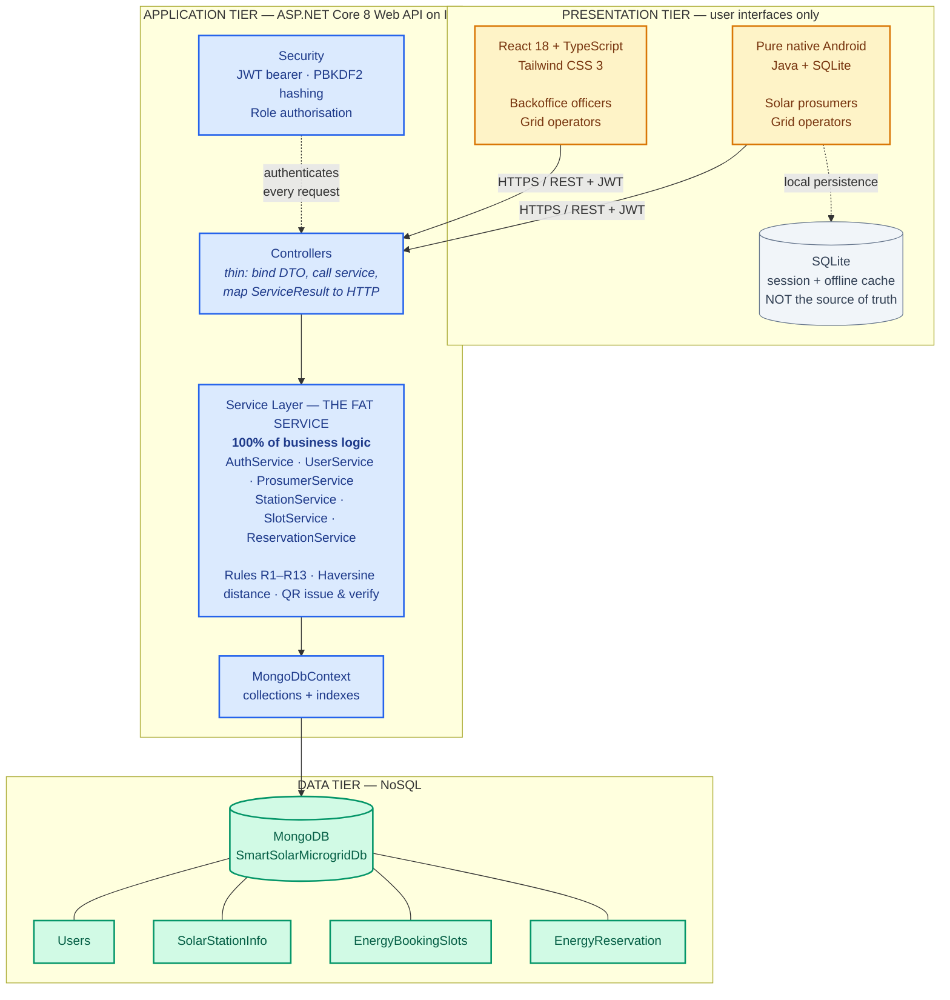
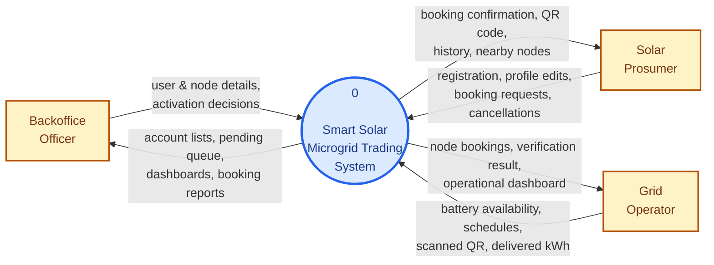
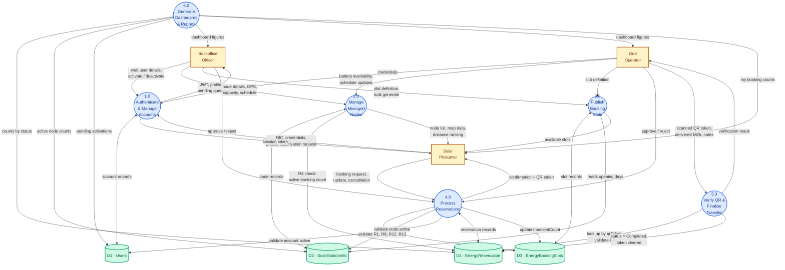
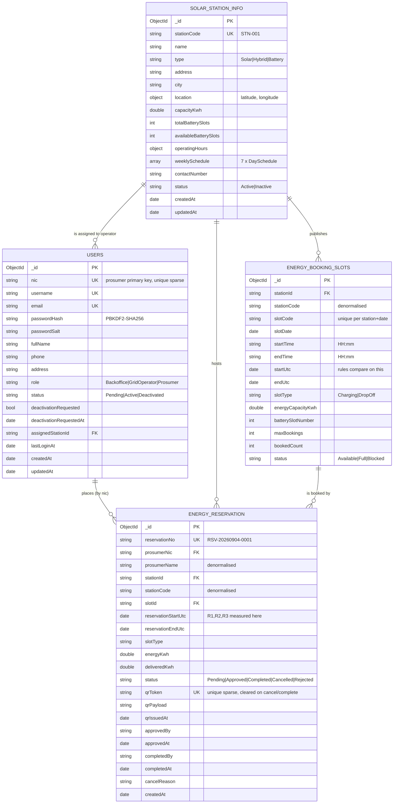
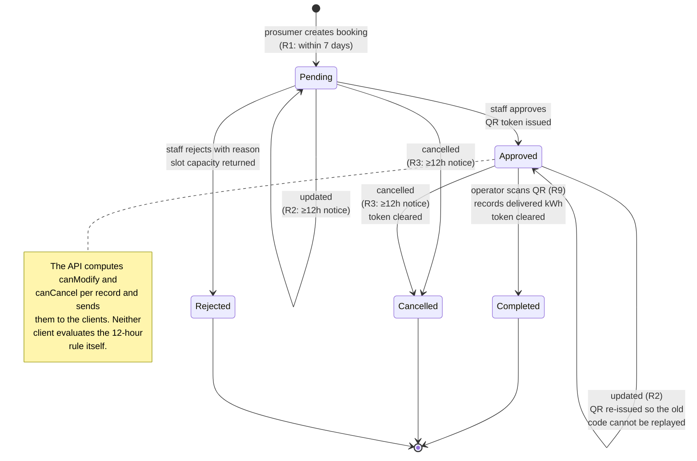
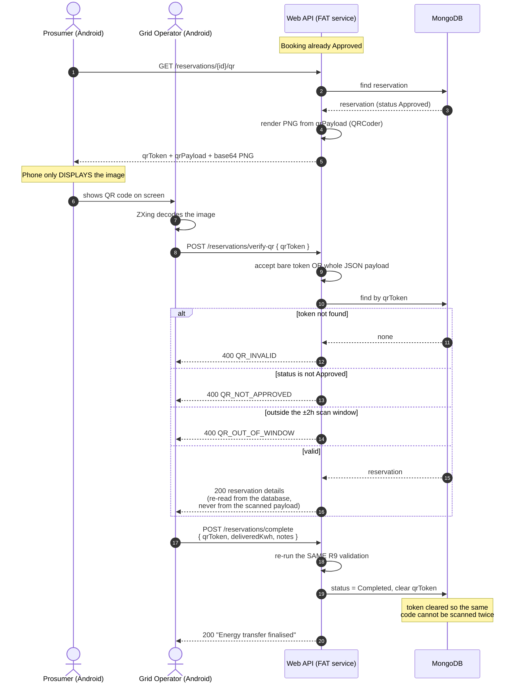

# System Diagrams
### Smart Solar Microgrid Trading System · SE4040

These diagrams are written in Mermaid so they stay in version control alongside the
code. GitHub renders them directly; to export images for the report, paste a block
into <https://mermaid.live> and download the PNG or SVG.

---

## 1. High-level architecture diagram

Shows the three tiers, what each is responsible for, and the single direction in which
data flows. Note that **neither client touches MongoDB** — that is the FAT-service
constraint the assignment sets.



---

## 2. Use case diagram

Three actors. Note that **Grid Operator is the only role on both clients**, and that
reactivating an account is reserved to the Backoffice officer (rule R5).

```mermaid
graph LR
    BO(["👤 Backoffice<br/>Officer"])
    GO(["👤 Grid<br/>Operator"])
    PR(["👤 Solar<br/>Prosumer"])

    subgraph SYS["Smart Solar Microgrid Trading System"]
        subgraph UM["Account management"]
            U1(["Create web user"])
            U2(["Manage prosumer<br/>profiles by NIC"])
            U3(["Activate / reactivate<br/>account &lpar;R5&rpar;"])
            U4(["Deactivate account"])
            U5(["Self-register<br/>with NIC"])
            U6(["Edit own profile"])
            U7(["Request own<br/>deactivation"])
            U8(["View pending<br/>activations"])
        end

        subgraph NM["Microgrid node management"]
            N1(["Create node with<br/>GPS + capacity"])
            N2(["Update node<br/>schedule"])
            N3(["Update battery<br/>availability"])
            N4(["Deactivate node<br/>&lpar;blocked if active<br/>bookings — R4&rpar;"])
            N5(["View nodes<br/>on map"])
        end

        subgraph RM["Reservation management"]
            R1(["Create booking<br/>&lpar;within 7 days — R1&rpar;"])
            R2(["Update booking<br/>&lpar;12h notice — R2&rpar;"])
            R3(["Cancel booking<br/>&lpar;12h notice — R3&rpar;"])
            R4(["Approve / reject<br/>booking"])
            R5(["View bookings<br/>&amp; history"])
            R6(["Search / filter<br/>bookings"])
            R7(["View dashboard<br/>counts"])
        end

        subgraph QR["Energy transfer"]
            Q1(["Receive QR code<br/>on approval"])
            Q2(["Scan prosumer<br/>QR code"])
            Q3(["Verify against<br/>server &lpar;R9&rpar;"])
            Q4(["Finalise transfer<br/>as done"])
        end

        subgraph SM["Slot management"]
            S1(["Create booking slot"])
            S2(["Generate slots<br/>in bulk"])
            S3(["Block / delete slot"])
        end
    end

    BO --- U1
    BO --- U2
    BO --- U3
    BO --- U4
    BO --- U8
    BO --- N1
    BO --- N2
    BO --- N4
    BO --- S1
    BO --- S2
    BO --- S3
    BO --- R4
    BO --- R6
    BO --- R7

    GO --- N2
    GO --- N3
    GO --- N5
    GO --- S1
    GO --- S2
    GO --- R4
    GO --- R5
    GO --- R6
    GO --- R7
    GO --- Q2
    GO --- Q3
    GO --- Q4

    PR --- U5
    PR --- U6
    PR --- U7
    PR --- N5
    PR --- R1
    PR --- R2
    PR --- R3
    PR --- R5
    PR --- R6
    PR --- R7
    PR --- Q1

    Q2 -.->|"&laquo;include&raquo;"| Q3
    Q4 -.->|"&laquo;include&raquo;"| Q3
    R2 -.->|"&laquo;include&raquo;"| R1

    classDef actor fill:#FEF3C7,stroke:#B45309,stroke-width:2px,color:#78350F
    class BO,GO,PR actor
```



---

## 3. Data flow diagram — Level 0 (context diagram)



---

## 4. Data flow diagram — Level 1

The four data stores map one-to-one onto the four MongoDB collections.



---

## 5. Database design — collection relationships

MongoDB is schemaless, but the application enforces this structure. Denormalised
copies (`stationCode`, `prosumerName`, …) are stored deliberately so a list screen
never needs a second query — a standard document-database trade-off.



---

## 6. Reservation life cycle (state diagram)



---

## 7. QR verification sequence

The critical security property: the server trusts **only the token** and re-reads every
other field from MongoDB. Nothing inside the scanned payload is believed.



---

## 8. Booking creation sequence — showing where each rule fires

```mermaid
sequenceDiagram
    autonumber
    actor P as Prosumer
    participant C as Client (web or Android)
    participant CT as ReservationsController
    participant SV as ReservationService
    participant DB as MongoDB

    P->>C: selects node, date, slot, kWh
    C->>CT: POST /api/v1/reservations
    Note over C: client sends NO prosumerNic;<br/>the API forces the caller's own (R11)
    CT->>SV: CreateAsync(request, caller)

    SV->>DB: load prosumer by NIC
    alt account not Active
        SV-->>CT: 403 ACCOUNT_PENDING / ACCOUNT_DEACTIVATED
    end

    SV->>DB: load slot + station
    SV->>SV: R13 — already booked this slot?
    alt duplicate
        SV-->>CT: 409 DUPLICATE_RESERVATION
    end

    SV->>SV: R1 — start in future and ≤ 7 days?
    alt outside window
        SV-->>CT: 400 RES_WINDOW_7_DAYS
    end

    SV->>SV: R12 — node open that weekday?
    alt closed
        SV-->>CT: 400 STATION_CLOSED
    end

    SV->>SV: R8 — slot Available and has capacity?
    alt unavailable
        SV-->>CT: 409 SLOT_UNAVAILABLE
    end

    SV->>DB: insert reservation (status Pending)
    SV->>DB: atomic $inc bookedCount +1
    SV-->>CT: 201 ReservationDto<br/>(canModify / canCancel computed here)
    CT-->>C: 201 + envelope
    C->>P: summary screen
```
